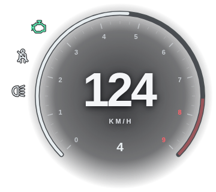

# zz-speedomter

A standalone, Forza-inspired FiveM vehicle HUD. No ESX, QBCore, database, npm build, CDN, custom fonts, or server-side scripts required. All UI assets ship with the resource.



Version 1.5.0 enlarges the dial by about 14% and the side icons by about 49% at the same configured scale. RPM smoothing is tuned for the existing 100-ms readings, so the arc keeps moving between packets. Lua polling and telemetry are unchanged. The default palette is silver-white, charcoal and grey, with semantic status colors. Icons and gear stay unboxed, with no branding, SPEED/GEAR captions or fuel display. Engine damage remains red, and static icon outlines preserve contrast over bright scenery.

See [INSTALL.md](INSTALL.md) for the step-by-step server owner's guide and [PERFORMANCE.md](PERFORMANCE.md) for the local optimization and visual review, including what still needs in-game validation.

The [source and visual review](REVIEW.md) compares this implementation with FiveM/MDN guidance, qb-hud and ps-hud, including the differences in polling rate and seatbelt cost.

## Install

If downloading this repository through **Code → Download ZIP**, rename the extracted `Speedometer-main` folder to `zz-speedomter` before installing it.

1. Copy this resource into `resources/[local]/zz-speedomter/`. `fxmanifest.lua` must be directly inside that folder, not another nested folder.
2. Add this line to `server.cfg`:

   ```cfg
   ensure zz-speedomter
   ```

3. Restart your server, or run `refresh` then `ensure zz-speedomter` from the server console. Enter the driver's seat of a road vehicle.

The folder may have another name; use that name in `ensure` and in integration exports. Disable any existing speedometer to avoid overlapping HUDs. GTA's original HUD is left intact.

## Included

- Digital speed, KM/H or MPH, gear, reverse detection, and normalized RPM arc with a redline state.
- Green/red engine status, headlights and high-beam indicators. No fuel meter or bottom RPM caption.
- Optional seatbelt toggle with exit blocking. The side icons show engine, belt, and light states; bikes have no belt indicator.
- Driver-only display by default; hides on foot, on death, in unsupported vehicle classes, and in the pause menu.
- Safe-zone-aware placement, configurable size and accent color, transparent NUI, and no input focus capture.

Edit `config.lua` and restart the resource to apply configuration changes:

| Option | Default | Purpose |
| --- | --- | --- |
| `Unit` | `'kmh'` | Initial speed units |
| `Scale` | `1.0` | HUD size, clamped to 0.65–1.5 |
| `Position` | right 32, bottom 28 | Pixel offset, plus GTA safe-zone inset |
| `Accent` | `'#e7edf0'` | Six-digit hex accent color |
| `MaxRpm` | `9000` | Estimated RPM tick scale; falls back to 9000 when omitted |
| `ShowPassenger` | `false` | Also display for passengers |
| `HideWhenPaused` | `true` | Hide when the pause menu is open |
| `UpdateInterval` | `100` | Combined speed, gear, RPM and vehicle checks in milliseconds; minimum 50 |
| `IdleInterval` | `750` | Vehicle detection interval on foot |
| `StatusInterval` | `500` | Engine health and light polling interval |
| `Classes` | Road classes | Eligible GTA vehicle classes |
| `Seatbelt.enabled` | `true` | Register belt control and show belt status |
| `Seatbelt.key` | `'B'` | Default key binding |
| `Seatbelt.blockExit` | `true` | Block normal exit while belted |

`/speedunit` toggles units; `/speedunit mph` and `/speedunit kmh` select explicitly. This choice lasts for the client session. **B** or `/zzbelt` toggles the belt. Players can remap the key under **Settings → Key Bindings → FiveM → zz-speedomter: toggle seatbelt**. Existing user mappings take precedence over a changed default.

The seatbelt feature blocks normal vehicle exit only. It does **not** change crash physics, implement ejection, provide damage protection, or make passengers invulnerable. Belt state resets on vehicle change, exit, or death. If another resource manages seatbelts, set `Config.Seatbelt.enabled = false` to avoid conflicting controls.

GTA supplies normalized RPM. The tick numbers estimate engine RPM in thousands using `MaxRpm`; they do not tune the engine. Neutral is shown when the engine is off or the native gear is zero; reverse is detected from backward motion. This is not a transmission simulation. Boats, aircraft, bicycles, and trains are excluded by default.

## Optional client integrations

These exports are client-side; replace `zz-speedomter` if you renamed the folder:

```lua
exports['zz-speedomter']:SetVisible(false) -- suppress, e.g. for a cinematic menu
exports['zz-speedomter']:SetVisible(true)  -- allow automatic vehicle visibility again

local success = exports['zz-speedomter']:SetSeatbelt(true)
local belted = exports['zz-speedomter']:IsSeatbeltOn()
```

`SetVisible(true)` does not force the HUD onto the screen outside eligible vehicles. `SetSeatbelt` returns false until the player is in an eligible vehicle with the belt feature enabled. The configured key still toggles the belt when using this export.

## Performance and validation

Speed, gear, RPM, engine-running state and vehicle eligibility share a 100-ms loop. Engine health and lights update every 500 ms. Each active tick sends at most one telemetry packet, containing only changed fields. RPM is rounded to half-percent increments to avoid tiny idle jitter. Hidden, paused or suppressed HUDs do not sample telemetry. There is no fuel integration or independent RPM worker; legacy `RpmInterval` and fuel settings are ignored.

The browser retains smooth, time-based arc interpolation through one on-demand `requestAnimationFrame` callback. Critically damped motion uses a 56-ms time scale, tuned for the default 100-ms telemetry interval. It advances to each packet’s receipt time before retargeting, preserving position and velocity even when packets arrive between frames. The spring adds roughly 110 ms of smoothing delay during a steady ramp, in addition to sampling delay; this short display delay smooths out the old surge-and-slow pattern. Animation stops when settled or hidden. Reduced-motion mode snaps directly to readings. Tick marks are rebuilt only when `MaxRpm` changes.

Compared with 1.3.0, default RPM reads fall from 625 to 100 in a deterministic 10-second simulation (84% fewer). Separate RPM packets and entity checks are removed. This measures work removed, not a percentage reduction in real CPU time. `Config.UpdateInterval = 100` is the recommended setting; lower values increase sampling and messaging cost.

The optional belt worker now calls only `DisableControlAction` per frame. Vehicle, seat and death validation share the main poll; a forced exit or vehicle switch releases the belt within one active polling interval (100 ms by default). There is no frame worker when unbelted. For an indicator without exit blocking, set `Config.Seatbelt.blockExit = false`. See `PERFORMANCE.md` for the work budget and in-game profiler checks.

The NUI startup handshake has a two-second request timeout and up to four retries, with increasing delays. Those timers stop after success; they are separate from vehicle updates.

No `0.00 ms` or fixed FPS claim is made. Actual CPU usage depends on your server, hardware, frame rate, and other resources. Use `resmon 1` in FiveM to check this resource on foot, driving, and belted. Lower `UpdateInterval` values increase native calls and NUI traffic.

### FiveM-only NUI

The NUI activates only when FiveM provides `GetParentResourceName`. Opening the HTML in a normal browser, including with `?preview`, stays blank. There are no full-screen presentation backgrounds, forms, or demo controls. Tests mock the FiveM interface externally; that harness is not part of the runtime resource.

The default footprint is approximately 360 × 320 pixels, including the side icons. Only local dial shading paints a background; icons and gear have no boxes. The page uses a normal color scheme and transparent root/body so embedded Chromium does not substitute an opaque dark canvas.

### Automated checks

Runtime deployment needs only the files listed in `fxmanifest.lua`. Run the following development checks from the repository checkout; the deployment ZIP omits the `tests` directory:

```sh
node --check web/app.js
lua5.4 tests/client_spec.lua
# Alternative on Linux with Python and liblua5.4 installed:
python tests/run_lua_tests.py

# Requires Python Playwright, Pillow, and Chromium for development only:
python tests/test_ui.py
# Optional local Chromium work counters; not an in-game benchmark:
python tests/profile_ui.py
```

Lua tests exercise the actual client code with a deterministic scheduler and mocked FiveM natives. Browser tests exercise the real page and NUI message protocol in Chromium. They cannot replace in-game native integration or resource profiling.

### FiveM acceptance check

1. `ensure zz-speedomter`; verify no errors in the client F8 console.
2. Enter a car, accelerate, brake, reverse, and switch units. Verify speed, gear, and RPM changes.
3. Toggle headlights/high beams, toggle the belt and try exiting. Unbelt and exit; verify the HUD hides.
4. Check pause/resume, driver/passenger behavior, a motorcycle, vehicle switching, and a resource restart while already driving.
5. Damage and repair the engine; verify the icon changes green/red correctly. Inspect `resmon 1` in each operating state.

## Layout

```text
zz-speedomter/
  fxmanifest.lua
  config.lua
  client.lua
  web/
    index.html
    style.css
    app.js
```

The resource has no server events, persistence, or gameplay authority. It reads local vehicle telemetry and optionally blocks the local exit control.
